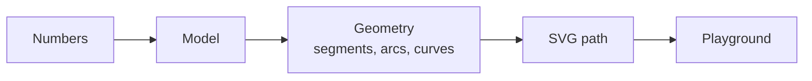
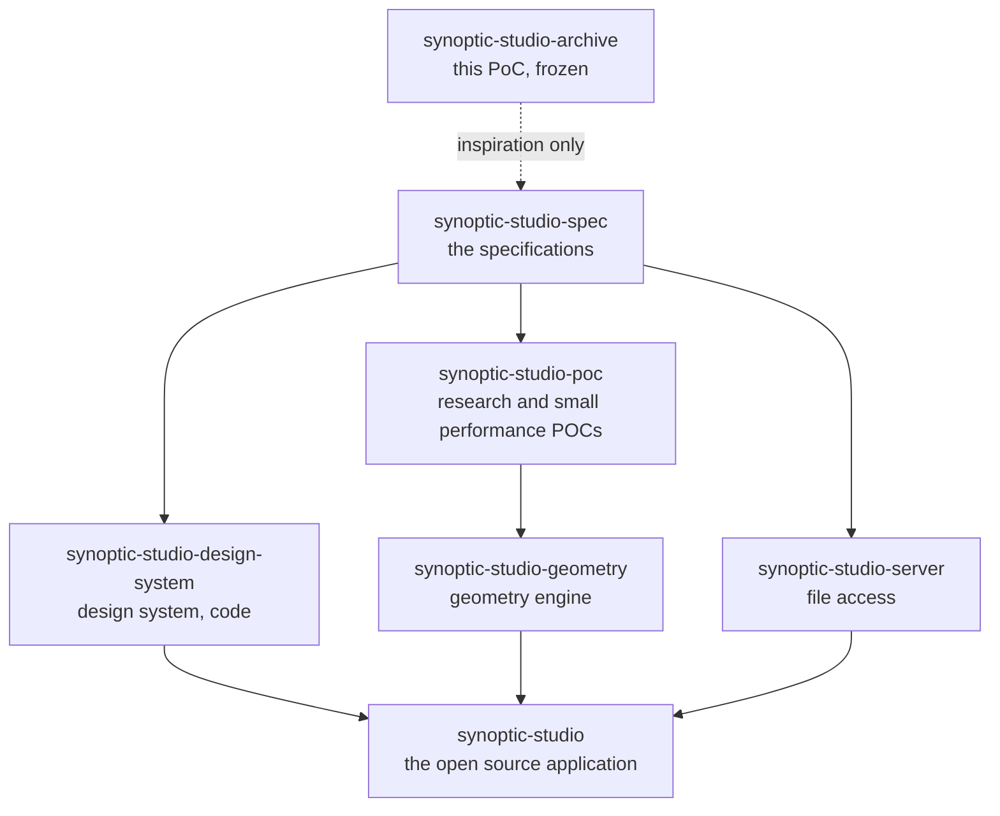

# Synoptic Studio Archive

> **Archive.** This repository is the first proof of concept (PoC) of Synoptic Studio, kept as it was. It is frozen: nothing is maintained, released or supported here, and it is **not** the Synoptic Studio application.

## What this is

Synoptic Studio is software to create and edit **synoptic views**: the schematic screens that supervise plants, networks and buildings. This repository holds the first, quick attempt at it, built to test the idea.

It is a dependency-free TypeScript library in which **every shape is defined by whole numbers** (sizes, radii, angles). The geometry is computed from them and each shape is written as one clean SVG `<path>`. A playground shows the library at work, and a documentation site describes it. The editors were meant to come once the library was complete; they were never built here.

It was built by an AI coding agent for one Product Owner, who decided what the software does, tried each change and validated each review. The last commit dates from 2026-10-25.

## Why it is kept

The Product Owner restarted Synoptic Studio from zero, with heavy specifications written first. This repository stays for one reason: to be **read for inspiration**.

- Its code is never taken as good code, nor as validated.
- No file of code from this repository is copied into the new repositories.
- Its history stays intact, so that what was tried can be found again.

## Where the real work is

The new Synoptic Studio is split into several repositories, one per project.

| Repository | What it holds |
| --- | --- |
| [`synoptic-studio`](https://github.com/AlexandreGallais/synoptic-studio) | The open source application. |
| [`synoptic-studio-spec`](https://github.com/AlexandreGallais/synoptic-studio-spec) | The specifications, written before any code. |
| [`synoptic-studio-design-system`](https://github.com/AlexandreGallais/synoptic-studio-design-system) | The design system as a code library. |
| [`synoptic-studio-poc`](https://github.com/AlexandreGallais/synoptic-studio-poc) | The documentary research and the small performance POCs. |
| [`synoptic-studio-geometry`](https://github.com/AlexandreGallais/synoptic-studio-geometry) | The geometry engine (intersections, shapes). |
| [`synoptic-studio-server`](https://github.com/AlexandreGallais/synoptic-studio-server) | The server, for everything that touches files. |

Not to be mixed up: `synoptic-studio-poc` is the new research project. This repository, `synoptic-studio-archive`, is the old PoC.

## What is inside

| Path | What it holds |
| --- | --- |
| `src/` | The library, in small named calculations (geometry, model and more), each with its tests. |
| `tests/` | Tests that cover the library as a whole. |
| `playground/` | The web page that shows each stage of the library at work. |
| `docs/` | The documentation site: [the software](./docs/the-software.md) and [how it is made](./docs/how-it-is-made.md). |
| `tools/`, `scripts/`, `Cargo.toml` | Rust tools and scripts for formatting, linting and checks. |
| `.agents/`, `.claude/`, `.mcp.json`, `AGENTS.md`, `CLAUDE.md` | The instructions and setup of the AI coding agent that built it. |
| `.github/`, `.githooks/` | The continuous integration, the issue templates and the Git hooks of the PoC. |

## Known limits of this archive

- The package metadata, the documentation site and some links still use the old repository name `synoptic-studio`, which now belongs to the new application. They were not updated, so as to leave the PoC as it was.
- The published documentation and playground were not checked after the rename, and are not maintained.
- Running it needs Node.js 24 and the Rust toolchain of `rust-toolchain.toml` (`npm install`, then `npm run dev` for the playground). This was not tried again after the rename.

## License

Apache-2.0: see [LICENSE](./LICENSE), [NOTICE](./NOTICE) and [THIRD-PARTY-LICENSES.md](./THIRD-PARTY-LICENSES.md). Security: [SECURITY.md](./SECURITY.md).
